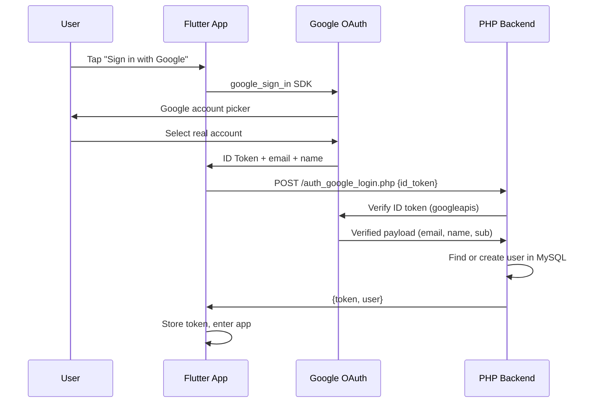

# Authentication Strategy: Google Sign-In Without Firebase

## The Problem
Users register with made-up Gmail addresses → they get in but can never recover their password because the email doesn't exist.

## Recommendation: **Google Sign-In via OAuth — Keep Your PHP/MySQL Backend**

You do **NOT** need Firebase. The `google_sign_in` Flutter package talks directly to Google's OAuth servers and gives you a verified Google identity. Your PHP backend stays exactly as-is for data storage.

> [!IMPORTANT]
> This approach guarantees every Google-authenticated user has a **real** Gmail address — Google has already verified it. No fake emails possible.

## How It Works

## What Changes

### Flutter Side (3 files)
| File | Change |
|---|---|
| `pubspec.yaml` | Add `google_sign_in: ^6.2.2` |
| `auth_service.dart` | Add `loginWithGoogle(idToken)` method |
| `login_page.dart` | Add "Sign in with Google" button |
| `register_page.dart` | Add "Sign up with Google" button (optional, same flow) |

### PHP Side (1 new file)
| File | Change |
|---|---|
| `auth_google_login.php` | **New** — verifies Google ID token, finds/creates user, returns app token |

### What Stays the Same
- ✅ Your MySQL database — all user data stays there
- ✅ `session_store.dart` — same token-based session
- ✅ `api_client.dart` — same HTTP + Bearer token pattern
- ✅ Admin/Barangay login — untouched
- ✅ Guest mode — untouched
- ✅ Email/password login — still works as a fallback (with your existing email verification)

## The Two Sign-In Options Going Forward

| Method | Who Uses It | Email Verified By |
|---|---|---|
| **Google Sign-In** | Primary for residents | Google (guaranteed real) |
| **Email + Password** | Fallback / Admin / Barangay | Your SMTP verification flow |

## Comparison: Why Not Firebase Auth?

| Criteria | Google Sign-In (OAuth only) | Firebase Auth |
|---|---|---|
| Keep MySQL as single source of truth | ✅ Yes | ❌ Split between Firebase + MySQL |
| PHP backend stays as-is | ✅ Yes | ❌ Need Firebase Admin SDK |
| Complexity | Low — 1 new PHP file | High — Firebase project, SDK, sync logic |
| Cost | Free | Free tier, but adds a dependency |
| Google-verified emails | ✅ Yes | ✅ Yes |
| Password recovery for email users | Your existing SMTP flow | Firebase handles it (but you lose control) |

> [!TIP]
> Firebase Auth makes sense when you're building a **new** app from scratch. For your case — where you already have a working PHP/MySQL backend — it would add complexity without meaningful benefit.

## Implementation Plan

### Phase 1: Google Sign-In (core fix)
1. Add `google_sign_in` package to Flutter
2. Create Google Cloud OAuth Client ID (Android)
3. Add "Sign in with Google" button to login page
4. Create `auth_google_login.php` endpoint
5. Test end-to-end flow

### Phase 2: Polish (optional)
6. Add Google Sign-In option to registration page
7. Link existing email accounts to Google (if same email)
8. Consider removing email/password registration entirely for residents

> [!NOTE]
> You'll need a **Google Cloud Console project** with OAuth 2.0 credentials (Android client ID using your app's SHA-1). This is free and separate from Firebase.

Here is a concise summary of the plan:

---

### **Core Goal**
Prevent fake email registrations and lockout issues by allowing residents to log in with **Google Sign-In**, while keeping your **existing PHP/MySQL database** as the single source of truth (no Firebase database required).

---

### **How It Works (Step-by-Step)**

1. **User Taps "Continue with Google" in Flutter**
   - The app uses the `google_sign_in` package.
   - Google displays the native account selector on Android/iOS.
   - **Result:** The email is guaranteed to be real and verified by Google.

2. **Flutter Sends Google Token to PHP**
   - Flutter gets Google's authentication token (`idToken`) and sends it via:
     `POST /api/v1/auth_google_login.php`

3. **PHP Backend Validates & Syncs with MySQL**
   - The PHP script verifies the token with Google's public keys.
   - **If user exists:** PHP generates your regular GabayBatas app session token.
   - **If user is new:** PHP automatically registers them in your MySQL `users` table as a verified resident, then returns the session token.

4. **App Session Continues Normally**
   - Flutter saves the returned token in [`session_store.dart`](file:///c:/xampp/htdocs/gabaybatas_app/lib/core/storage/session_store.dart) just like normal login.
   - Navigation and API authorization remain identical.

---

### **What Stays Unchanged**
- **Existing MySQL database & tables** stay exactly as they are.
- **Admin & Barangay logins** remain untouched.
- **Email + Password login** remains available as a fallback.
- **Guest mode** remains available.

---

### **Implementation Steps**
1. **Google Cloud Console**: Ensure your OAuth 2.0 Android Client ID / Web Client ID is set up (using your keystore SHA-1).
2. **Flutter App**:
   - Add `google_sign_in` to [`pubspec.yaml`](file:///c:/xampp/htdocs/gabaybatas_app/pubspec.yaml).
   - Add `loginWithGoogle()` in [`auth_service.dart`](file:///c:/xampp/htdocs/gabaybatas_app/lib/features/auth/data/auth_service.dart).
   - Add "Sign in with Google" button to [`login_page.dart`](file:///c:/xampp/htdocs/gabaybatas_app/lib/features/auth/presentation/login_page.dart).
3. **PHP Backend**:
   - Add `auth_google_login.php` to verify the token, create/lookup the user in MySQL, and return the session token.